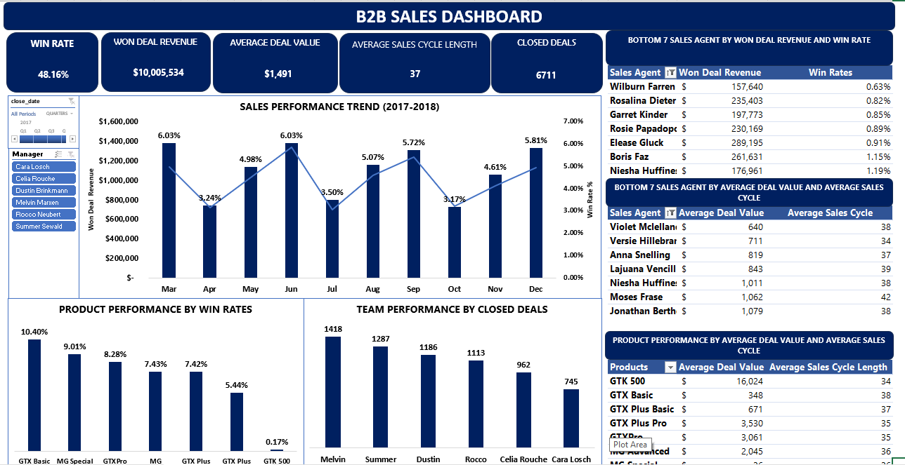
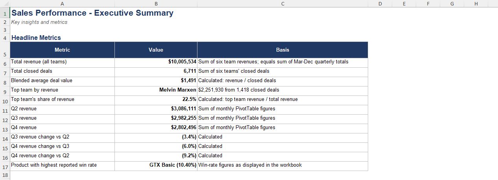
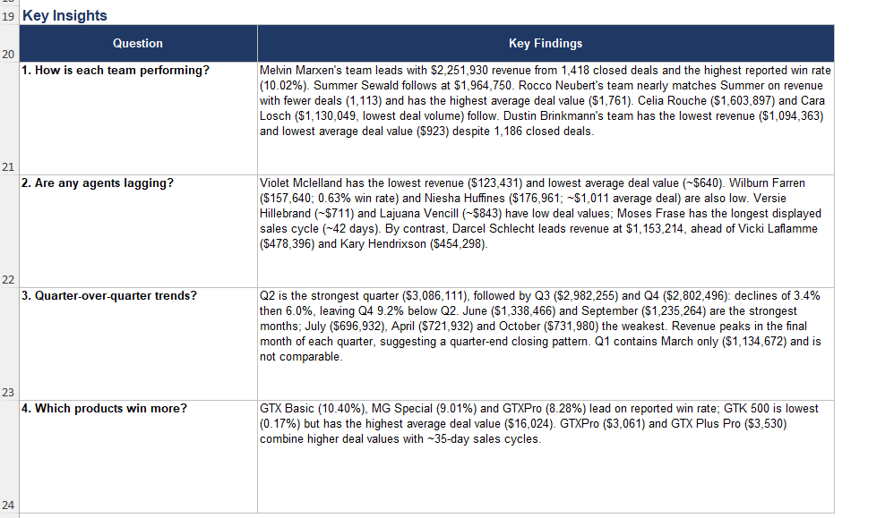

#B2B_Sales_Performance
# B2B Sales Performance Analysis

An Excel analysis of a B2B sales pipeline: team and agent performance, quarterly revenue trends, and product win rates, with a dashboard and a set of recommendations.

## Project Overview

The data covers 8,800 sales opportunities (deals closed March to December 2017) across 30 sales agents, 6 sales teams, 3 regional offices, 7 products and 85 customer accounts.

The analysis answers four questions:

1. How is each sales team performing?
2. Are any agents lagging?
3. How is revenue trending quarter over quarter?
4. Which products win more deals?

## Files

| File | Description |
| --- | --- |
| `B2B_sales_data_analysis.xlsx` | Cleaned data, PivotTable analysis and the B2B Sales Dashboard |
| `Sales_Executive_Summary_and_Recommendations.xlsx` | Executive summary and recommendations |

## Data

The workbook combines four tables: **sales pipeline**, **accounts**, **products** and **sales teams**. Each opportunity moves through the stages Prospecting, Engaging, then Won or Lost. I cleaned the pipeline and joined it with team, region, and account details, and added a won/not-won flag and sales cycle length as part of feature engineering. Field definitions are in the `data_dictionary` sheet.

## Key Findings

- **Total revenue:** $10,005,534 from 6,711 closed deals (average deal value about $1,491).
- **Top team:** Melvin Marxen ($2,251,930), about 22.5% of revenue.
- **Lowest team:** Dustin Brinkmann ($1,094,363), with the lowest average deal value ($923) despite 1,186 closed deals.
- **Highest deal value:** Rocco Neubert's team ($1,761 average).
- **Lagging agents:** Violet Mclelland, Wilburn Farren, Niesha Huffines, Versie Hillebrand and Lajuana Vencill.
- **Top agent:** Darcel Schlecht ($1,153,214).
- **Revenue is declining:** Q3 was 3.4% below Q2 and Q4 was 6.0% below Q3 (9.2% below Q2).
- **Quarter-end pattern:** revenue peaks in June, September and December.
- **Products:** GTX Basic (10.40%) and MG Special (9.01%) have the highest win rates. GTK 500 has the lowest win rate (0.17%) but the highest average deal value ($16,024).

## Recommendations

1. Increase deal value in lower-revenue teams through upsell and cross-sell training.
2. Give targeted support to lagging agents.
3. Investigate the second-half revenue decline and review pipelines monthly.
4. Reduce dependence on quarter-end sales.
5. Balance product volume with revenue potential.
6. Define win rate and deal value clearly, and improve data quality.

## How to Use

1. Download or clone the repository.
2. Open `B2B_sales_data_analysis.xlsx` in Microsoft Excel.
3. Use the slicer on the **B2B Sales Dashboard** sheet to filter by sales team.

## Notes

- Win rate and average deal value are displayed figures whose definitions should be confirmed before they are used for targets.
- The data includes March only for Q1, so Q1 is not comparable with other quarters.

## Tools

Microsoft Excel (Data cleaning, Power Query, PivotTables, charts, slicers)
